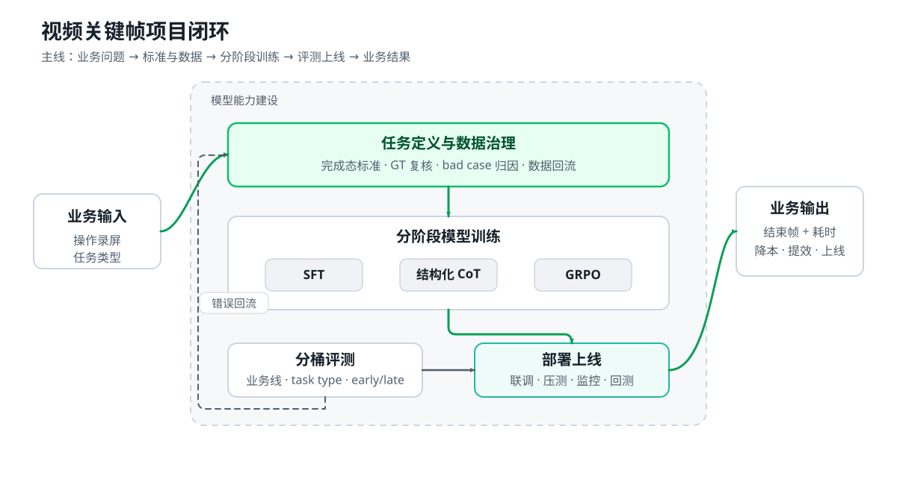
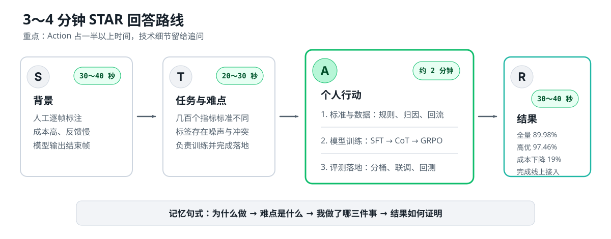

# 面试优化表达

本文档只保存表达优化分析和可直接口述的最终版本。本人未经修改的回答保存在[面试问题与原始表达](面试问题与原始表达.md)中。

## 问题 1：请做一个简单的自我介绍

### 优化目标

控制在 3～4 分钟，只介绍实习经历和科研经历。每段项目内部按照“背景与目标—个人行动—量化结果”组织，不机械复述简历。

主要调整：

- 把项目背景压缩到“业务问题、任务目标”两句话，不再展开多个指标示例。
- 合并任务治理和数据治理，避免重复解释“人工经验没有沉淀”。
- 模型训练只保留 SFT、结构化 CoT 和 GRPO 这条主线，把具体 reward、OPD 和部署参数留给追问。
- 每段经历只保留能够证明个人行动和结果的指标，区分已经落地的成果与仍在探索的方案。

### 优化版本

面试官您好，我叫于天浩，是北京邮电大学计算机专业的应届生，主要方向是多模态模型训练和 AI 安全。下面我重点介绍实习和科研经历。

实习方面，我目前在字节跳动担任算法实习生。我的主项目是视频关键帧识别，目标是用模型自动定位操作录屏中的结束帧，替代抖音、番茄等业务的部分人工标注。

我主要做了三件事：第一，把依赖人工经验的完成态标准转化为模型可执行的条件，并通过 bad case 归因区分人工标注、沉淀标准和模型能力问题；第二，基于 Qwen3-VL-8B 模型搭建监督微调、结构化 CoT 数据蒸馏和 GRPO 的训练流程，重点优化抢跑、滞后和细粒度元素识别；第三，通过多轮数据飞轮返修 5 万条高价值样本，沉淀 22 万条业务真实数据，并参与接口联调、压测和线上回测。最终，全量 ACC 从 75.71% 提升到 89.98%，高优业务线从 84.09% 提升到 97.46%，标注成本下降 19.00%，并完成线上接入。

我的第二项实习工作是端模安全评估。我基于 SigLIP2 研究黑盒对抗攻击，通过多层视觉特征扰动和动量迭代暴露模型风险，使攻击场景准确率降至 31.35%，并沉淀 5000 多条对抗样本，用于后续安全训练。

科研方面，我主要研究黑盒、跨模型和跨任务的对抗攻击。第一项工作是图文协同的多模态黑盒攻击，我作为一作，联合优化图像特征、图文对齐关系和文本扰动。跨模型图文检索的平均攻击成功率从 SOTA 工作的 75.04% 提升到 85.01%，在 GPT、Qwen 等多模态大模型上从 14.28% 提升到 18.28%。第二项工作是跨视觉任务的通用扰动研究，我作为二作参与设计单扰动跨分类、检测和分割任务的攻击框架，论文已被 KBS 2026 录用。

总体来说，我既有数据治理、模型训练和上线落地的完整实践，也持续研究多模态模型的安全鲁棒性问题。以上是我的自我介绍。

## 问题 2：详细地介绍一下你在字节公司的模型训练部分的工作吧。你做的是什么？你主要做了什么？

### 优化目标

将原来约 8 分钟的回答压缩到 3～4 分钟，按照 STAR 法则组织：

- 背景和任务：快速讲清业务为什么需要关键帧模型，以及模型的输入输出。
- 个人行动：重点说明任务与数据治理、分阶段训练、评测上线三项工作。
- 量化结果：集中汇报模型效果、业务价值和落地状态。

原回答中“数据治理”和“任务治理”存在重复，训练方法也缺少选择原因。优化后不再逐项解释业务指标，而是说明每个训练阶段解决的具体问题，并把仍在探索的在线蒸馏与已经落地的方案分开。

### 项目框架图

项目主线是：从人工性能评测的业务问题出发，先统一任务标准并治理数据，再通过 SFT、结构化 CoT 和 GRPO 分阶段构建模型能力，最后完成分桶评测、部署上线和 bad case 回流。

### 回答框架图

回答时只记住四个锚点：为什么做、难点是什么、我做了哪三件事、结果如何证明。其中“个人行动”是主体，技术细节留给面试官追问。

### 优化版本

我在字节主要负责视频关键帧识别模型的后训练和落地。项目面向抖音、番茄等业务的性能评测。过去需要人工逐帧找到操作完成的第一帧，再计算耗时，成本高、反馈慢。因此，我们希望让模型输入视频和任务类型，自动输出首次满足业务标准的结束帧，用模型预标替代部分人工标注。

这个任务的难点是几百个业务指标的完成标准不同，而且历史数据存在标签噪声和标准冲突。我的工作主要分为三部分。

第一是任务定义和数据治理。我把人工经验拆成必须条件、排除条件、豁免条件和证据优先级，并通过模型分歧和 bad case 归因，区分标签错误、标准冲突和真实模型错误，人工复核后再回流训练。通过多轮数据飞轮，我们累计返修 5 万条高价值样本，沉淀 22 万条真实业务数据。

第二是模型训练。我基于 Qwen-VL 系列模型搭建分阶段流程：先通过 SFT 建立视频理解、任务遵循和稳定输出能力；再做结构化 CoT 蒸馏，让模型利用前后帧证据判断当前帧为什么首次完成；最后针对抢跑、滞后和细粒度边界问题使用 GRPO，把时间误差、输出格式和视觉证据设计成可验证奖励，强化正确边界。

第三是评测和落地。我按业务线、任务类型和 early、late 错误进行分桶评测，并参与接口适配、全链路联调、压测、监控和线上回测。

最终，模型全量 ACC 从 75.71% 提升到 89.98%，高优业务线从 84.09% 提升到 97.46%，标注成本下降 19.00%，并完成线上接入。目前在线蒸馏仍处于探索阶段，主要用于解决长视频中局部证据被稀释的问题，我不会把它作为已落地成果。
