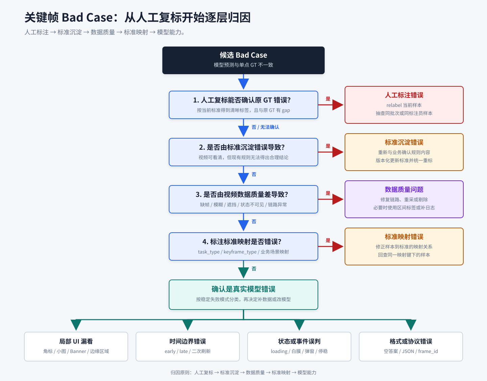

# 关键帧检测：Bad Case 归因与 UI 元素治理

## 知识点解析

### 概述

本文整理关键帧检测中的 bad case 归因方法和 UI 元素治理思路，重点区分人工标注、标准沉淀、数据质量、标准映射和真实模型错误。

### 为什么要做 bad case 归因

模型指标下降不一定代表模型能力差，可能来自：

- 人工标注错误：复核人员按照标准可以得到清晰标签，且与原 GT 存在差异。
- 标准沉淀错误：复核人员无法得到合理标签，进一步检查发现完成态、排除条件、豁免条件或证据优先级本身有误。
- 数据质量问题：视频不可用或视觉证据不足，人工也无法可靠确定完成帧。
- 标准映射错误：标准本身没有问题，但样本的 `task_type`、`keyframe_type` 或业务场景映射到了错误标准。

只有排除以上四类问题后，才能把偏差归为真实模型错误。如果直接把所有错误样本回流训练，会把不可判定数据、错误标准和脏 GT 一起教给模型。

### 归因流程



具体判断标准见[任务定义与标注标准](<任务定义与标注标准.md#关键帧检测任务定义与标注标准>)。

归因从人工独立复标开始。若能够得到清晰标签且与原 GT 有差异，归为人工标注错误；若无法清晰判断，再区分是沉淀标准有误，还是视频证据不足。上述问题都排除后，再检查标准映射，最后才归因模型能力。

### Agent 辅助归因

在 bad case 较多时，可以让 [Agent](<../../../08_Agent/基础概念/Agent.md#agent>) 先做结构化初筛，再由人工完成最终裁决。Agent 需要同时读取视频证据和 task_type 规则，至少输出：

| 维度 | 诊断内容 |
| --- | --- |
| 视频证据 | 预测帧、GT 帧和前后帧的 UI 状态变化 |
| 业务标准 | 当前任务要求等待哪些元素，哪些变化可以豁免 |
| 模型行为 | 是否偏早、偏晚、漏看小元素或输出格式错误 |
| 数据分布 | 错误是否集中在某类页面、元素或业务线 |
| 候选归因 | 人工标注、标准沉淀、数据质量、标准映射或模型能力问题 |

Agent 适合做筛选、摘要和聚类，不应直接替代人工改标签。只有确认视频证据和任务标准一致后，样本才进入 relabel、规则修正或训练回流。

### 主要 bad case 类型

| 类型 | 表现 | 处理方式 |
| --- | --- | --- |
| 人工标注错误 | 复核人员能够得到清晰标签，且与原 GT 存在差异 | relabel，并抽检同批次或同标注员样本 |
| 标准沉淀错误 | 按现有标准无法合理判断，或判断结果与真实业务规则冲突 | 与业务重新确认并版本化更新标准，再统一重标 |
| 数据质量问题 | URL、解码、帧索引异常，或缺帧、模糊、遮挡导致人工无法判断 | 修复链路、重采、剔除或改用区间标签 |
| 标准映射错误 | 样本被路由到不匹配的 `task_type`、`keyframe_type` 或业务标准 | 修正映射配置，并回查同一映射键下的样本 |
| 小面积 UI 元素漏看 | 角标、折扣标签、小图、按钮状态未识别 | 构造 UI 元素识别数据，增强局部感知 |
| 购物车角标变化漏判 | 加购后角标数字变化小，模型看不到或未优先判断 | prompt 明确数字变化优先级，补充角标样本 |
| 营销 Banner 未加载 | 模型认为商品主体出现即可，但标准要求 Banner 完整 | 标准中明确营销元素是否必需 |
| 边缘小图漏看 | 屏幕边缘商品图或缩略图未加载 | 增加区域注意和边缘元素训练样本 |

### 数据质量问题

数据质量既包括链路异常，也包括视觉不可判定。常见原因包括：

- 数据 URL 不可下载、视频无法解码，或 FPS、裁剪偏移和帧索引不一致。
- 帧率过低或视频缺帧，完成态第一次成立的瞬间没有被录到。
- 压缩、模糊、遮挡或裁剪使关键 UI 元素无法辨认。
- 页面变化连续且差异极小，只能确定关键帧位于一个时间区间。
- 任务完成依赖网络请求、按钮可交互等不可见状态，仅凭录屏无法确认。

治理时先由多名标注员独立判断，再复核分歧原因。若仍不存在稳定视觉证据，应标记为“不可判定”，从单点 GT 的训练集和严格评测集中剔除，并推动重新采集；若业务允许误差范围，可以保留最早可能帧和最晚确定帧作为区间标签。对于视觉上不可观测的状态，应补充埋点、事件日志或其他信号，而不是强迫人工选择一个看似精确的帧。否则模型会学习随机标签，离线 ACC 也无法真实反映能力。

### 标准映射错误与标准沉淀错误

两者都表现为“模型与 GT 不一致”，但修复位置不同：

- 标准映射错误是路由问题。标注标准本身可能正确，但样本根据错误的 `task_type`、`keyframe_type` 或业务场景拿到了另一套标准。修复时要修改映射关系，并回查使用同一映射键的样本。
- 标准沉淀错误是规则内容问题。样本已经映射到目标标准，但该标准对完成态、排除条件、豁免条件或证据优先级描述错误或不完整。修复时要重新与业务确认标准、更新版本，并对受影响样本统一重标。

两者的修复位置仍然不同：标准沉淀错误要修改规则内容，标准映射错误要修改路由配置。实际归因时先通过人工复标和业务规则检查判断标准是否沉淀正确，前述问题都排除后，再检查系统是否把正确标准映射到了当前样本。

### 具体观察

UI 元素问题中，高频指标包括：

- 商详页加载耗时 - 商城：20 个 bad case 中 16 个涉及小面积 UI 元素或营销 Banner。
- 购物车加购耗时 - 商城商详：43 个 bad case 中，15 个涉及购物车角标数字变化，7 个涉及“加购成功”文本判断。
- 店铺独立页加载耗时、购物车加载耗时、搜索结果页加载耗时等也存在边缘小图或小面积元素漏看。

这些问题说明模型不是完全不会做关键帧定位，而是对局部 UI 元素、边缘区域和业务优先级理解不足。

### UI 元素治理

可以引入 UI primitive 思路，把复杂页面拆成可识别、可验证的元素：

| Primitive | 示例 | 用途 |
| --- | --- | --- |
| 状态 primitive | loading、白膜、弹窗、按钮可交互 | 判断页面是否完成 |
| 区域 primitive | 顶部头图、底部按钮、购物车区域、Banner 区 | 绑定空间证据 |
| 事件 primitive | 数字变化、弹窗出现、图像滑动停稳 | 判断时间边界 |
| 文本 primitive | 价格、折扣、加购成功、SKU 文案 | 辅助业务规则 |

后续训练可以让模型不只输出帧号，还输出：

```text
frame_id: 2741
region: top-right cart badge
state_change: number increased
evidence: cart badge changed from 18 to 19
decision: end frame
```

### OmniParser 类方法的迁移价值

OmniParser 的思路是先解析 UI 屏幕，识别文本、图标、按钮和可交互区域，再让模型基于结构化 UI 信息完成任务。这对关键帧检测有三点价值：

1. 给营销 Banner、折扣标签、购物车角标、小图等生成候选区域。
2. 从 prompt 中提取需要识别的 UI 元素，只对相关元素重点判断。
3. 将 UI 元素名和视觉区域对齐，缓解模型“不知道这个 UI 是什么”的问题。

### 常见考法与解题方法

| 考法 | 怎么考 | 怎么解 |
| --- | --- | --- |
| 归因题 | bad case 怎么分析 | 人工复标后依次判断人工标注、标准沉淀、数据质量、标准映射和模型能力 |
| 小元素题 | 模型看不到角标怎么办 | 补 UI primitive、区域证据和高分辨率精筛 |
| 数据题 | 错样本都回流吗 | 先 relabel 和归因，脏 GT 不直接训练 |
| 数据质量题 | 人工也无法精确判断怎么办 | 标记不可判定，剔除或重采；必要时使用区间标签或补充日志 |
| 标准题 | 映射错误和沉淀错误有什么区别 | 映射错误是套错规则；沉淀错误是规则内容本身错误 |
| 方案题 | 怎么提升 UI 细粒度理解 | UI 元素识别、区域检测、结构化证据、局部高 FPS |

### 易错点

- 把所有 bad case 都归为模型能力问题。
- 不看前后帧，只看预测帧和 GT 帧。
- 对人工也无法判断的样本强行给出单点 GT。
- 混淆标准映射错误和标准沉淀错误，导致修错位置或扩大重标范围。
- 小元素问题只靠 prompt 解决，忽略分辨率和区域定位。
- 标注标准没和业务确认就直接改训练数据。

## 面试应对

### 你怎么做 bad case 归因？

回答思路：给出流程和归因类型。

回答模板：

我会先人工看一遍视频，按照当前标准独立复标。如果能得到清晰标签，而且和原 GT 有差异，就归为人工标注错误。如果我也无法明确判断，就继续区分原因：如果视频本身清晰，但按照现有标准无法得到合理结论，说明标准沉淀有问题；如果是缺帧、模糊、遮挡或关键状态不可见，说明是数据质量问题。前面都没有问题时，再检查样本是否映射到了错误的 task_type、keyframe_type 或业务标准。全部排除后，才归为模型能力问题，并继续细分是小 UI 元素识别、状态判断还是 early/late 边界能力不足。
