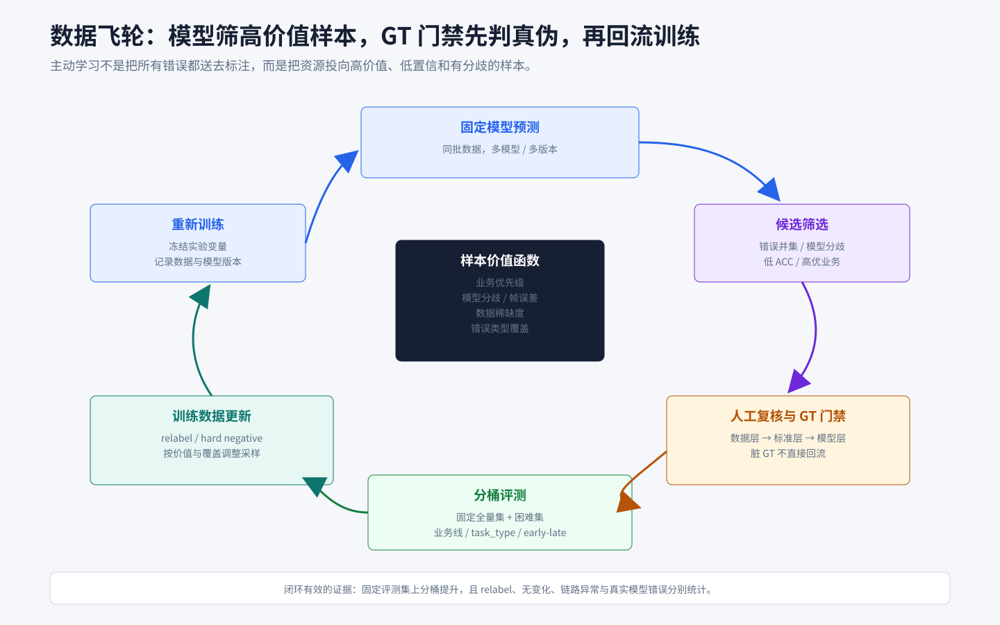

# 关键帧检测：数据飞轮与主动学习

## 知识点解析

### 概述

本文整理关键帧检测中的数据飞轮和主动学习思路，包括样本筛选、人工重标、数据回流、分桶评测、采样配比和高优指标治理。更完整的 Agent 规划、策略搜索、训练执行和自动准出闭环见[Agentic Model Optimization 模型自训练优化.md](<Agentic Model Optimization 模型自训练优化.md#agentic-model-optimization模型自训练与-loop-engineering>)。

### 什么是主动学习

主动学习（Active Learning）是一种以降低标注成本为目标的数据选择方法。它不是对未标注数据随机抽样，而是让当前模型根据不确定性、模型分歧、代表性或预期收益，从未标注样本池中挑出最有信息量的一批样本，请人工标注后加入训练集，再重新训练模型并重复这一过程。

```text
少量已标注数据训练初始模型
  -> 模型扫描未标注样本池
  -> 采集函数选择高价值样本
  -> 人工标注
  -> 加入训练集并重新训练
  -> 重复迭代
```

其中“主动”体现在样本由模型按信息价值选择，而不是体现在模型自动生成标签。经典主动学习通常包含四个要素：

- 未标注样本池：等待选择和标注的数据。
- 采集函数：衡量哪些样本最值得标注，例如预测熵、置信度差距、多模型分歧或样本代表性。
- 标注者：人工或其他可靠标注系统，为选中的样本提供真实标签。
- 迭代闭环：新标签回流训练后，使用更新后的模型重新选择下一批样本。

主动学习与相近概念的区别是：

| 方法 | 选择对象 | 核心目的 |
| --- | --- | --- |
| 随机采样 | 随机未标注样本 | 获得近似总体分布的数据 |
| 主动学习 | 模型选出的未标注样本 | 用更少标注获得更大模型收益 |
| 难例挖掘 | 已标注但模型预测错误的样本 | 强化模型薄弱能力 |
| 数据飞轮 | 新数据、旧数据、标注、训练和评测的持续闭环 | 持续改善数据与模型 |

因此，主动学习是一种样本选择策略，数据飞轮是更大的持续迭代系统。主动学习可以成为数据飞轮的一个环节，但二者不是同义词。

### 为什么需要数据飞轮

关键帧检测数据有三个特点：

- 指标多：训练集覆盖 172 个指标，测试集覆盖 110 个指标。
- 业务线多：国际电商、番茄系、搜索系等能力边界不同。
- 分布长尾：少数指标样本很多，很多指标样本不足或效果低。

平均补数据会稀释资源，无法优先解决业务准出卡点。数据飞轮的目标是把标注资源投向最有价值的错误样本。

### 数据规模

| 数据 | 规模 | 说明 |
| --- | --- | --- |
| 全量沉淀 | 15w+ | 覆盖 25Q1-26Q1 |
| 训练集 | 11w+ | 25Q1-Q4，覆盖 172 个指标 |
| 测试集 | 4w+ | 26Q1，覆盖 110 个指标 |
| 飞轮返修 | 27000+ | 三轮高质量样本返修 |
| 国际电商核心指标 | 30+ | 高优业务重点治理 |

### 数据飞轮流程

```text
固定候选模型
  -> 同批数据多模型预测
  -> 取错误样本并集
  -> 人工复查 / CQC 重标
  -> 标记错误类型和业务线
  -> 回流训练
  -> 分桶评测
  -> 决定下一轮采样策略
```



项目使用多个固定模型筛选同一批数据，取 bad case 并集作为高价值复核候选。如果候选来自未标注样本池，再由人工首次标注，属于主动学习；如果样本已有 GT，只是根据模型错误进行复查和重标，则更准确地说是难例挖掘或主动数据选择。两者都比随机抽样更集中地利用标注预算，但概念上需要区分。

### 回流前的质量门禁

模型预测和 GT 不一致时，不能直接把样本视为模型错误。回流前应先完成三层判断：

1. **数据层**：视频是否可解码，时间坐标、FPS、裁剪偏移和帧索引是否一致。
2. **标准层**：GT 是否符合当前 task_type 的完成态、排除条件和豁免条件。
3. **模型层**：在数据和标准都可靠的前提下，判断模型是否漏看 UI 元素、错过边界帧或错误遵循规则。

可以将候选样本分为以下几类：

| 样本类型 | 后续动作 |
| --- | --- |
| GT 确认错误 | 修改标签后再进入训练或评测 |
| 标准存在歧义 | 先完成业务规则对齐，再决定是否回流 |
| 模型确实错误 | 作为高价值样本或 hard negative 回流 |
| 视频/链路异常 | 修复数据链路，不计入模型能力判断 |
| 无有效变化 | 保留统计信息，避免误算成模型收益 |

Agent 可以在这一步完成前后帧摘要、错误聚类和候选归因，但最终 relabel 仍应由人工确认。

### 样本选择策略

| 策略 | 适用样本 | 目的 |
| --- | --- | --- |
| 高优业务优先 | 国际电商核心指标 | 直接支撑业务准出 |
| 低 ACC 指标优先 | 购物车加购等弱项 | 抬高短板 |
| 数据量不足优先 | 训练量为 0、<500、<900 指标 | 补齐覆盖 |
| 标准冲突优先 | 不同标注员判断不一致 | 修正任务边界 |
| 模型分歧优先 | 多模型预测不一致 | 找困难样本 |
| bad case 聚类 | 同类错误集中出现 | 构造专项训练集 |

### 主动学习视角

关键帧项目可以把主动学习作为数据飞轮中的样本选择环节：

```text
未标注样本上的模型不确定性 / 模型分歧
  -> sample selection
  -> human annotation
  -> training data update
  -> model retraining
  -> evaluation feedback
```

这里的“uncertainty”不一定来自概率熵，也可以来自：

- 多模型预测分歧。
- 同一模型多次采样结果不一致。
- 完成态附近多个时间点得分接近。
- 样本距离已有训练数据较远。

与 GT 的帧误差、高优业务线低分和人工复查发现的标准冲突，需要已有标签或评测结果，更接近难例挖掘和业务优先级采样，而不是经典主动学习中的未标注样本不确定性。

### 采样配比

后续数据配比不应只按样本量均匀采样：

- 高数据量高 ACC 指标：降低采样比例，避免冗余样本占用训练预算。
- 低数据量低 ACC 指标：提高采样比例，补足基础能力。
- 高数据量低 ACC 指标：优先做 bad case 归因，判断是标准问题还是模型能力问题。
- 低数据量高 ACC 指标：保留少量样本维持能力，避免过拟合。

### 效果判断

不能只看全量平均 ACC。至少要看：

- 全量 ACC。
- 业务线 ACC。
- 分 task_type ACC。
- Acc@1、Acc@3。
- bad case 类型变化。
- relabel 比例和无变化比例。
- 线上回测结果。

### 常见考法与解题方法

| 考法 | 怎么考 | 怎么解 |
| --- | --- | --- |
| 数据闭环 | 数据飞轮怎么做 | 模型筛错、人工重标、回流训练、分桶评测 |
| 主动学习 | 和随机采样区别 | 优先标注模型易错和高价值样本 |
| 采样策略 | 长尾指标怎么处理 | 按数据量、ACC、业务价值分层 |
| 效果评估 | 怎么判断飞轮有效 | 看业务线、task_type、bad case 类型和线上回测 |

### 易错点

- 把数据飞轮说成单纯补数据。
- 不区分 relabel 样本和无变化样本。
- 只看平均 ACC，忽略高优指标。
- 把脏 GT 直接回流训练。
- 没有固定评测集，导致迭代效果不可比。

## 面试应对

### 数据飞轮和主动学习怎么结合？

回答思路：先区分主动学习与数据飞轮，再用“模型选样 + 人工标注或复核 + 回流训练”解释项目落地。

回答模板：

主动学习是一种样本选择策略，核心是让模型从未标注样本池中挑出最值得人工标注的数据；数据飞轮则是覆盖选样、标注、训练和评测的完整闭环。在关键帧项目中，我会用多模型分歧、预测不稳定和边界不确定性筛选未标注样本，交给人工标注后回流训练；对于已有 GT 的样本，则根据帧误差、低 ACC 指标和 bad case 聚类做难例挖掘，再人工复核和重标。两类样本统一按业务线、task_type 和错误类型管理，并在固定回归集上验证收益。这样既利用主动学习降低新增标注成本，也通过难例挖掘持续修复模型短板。
